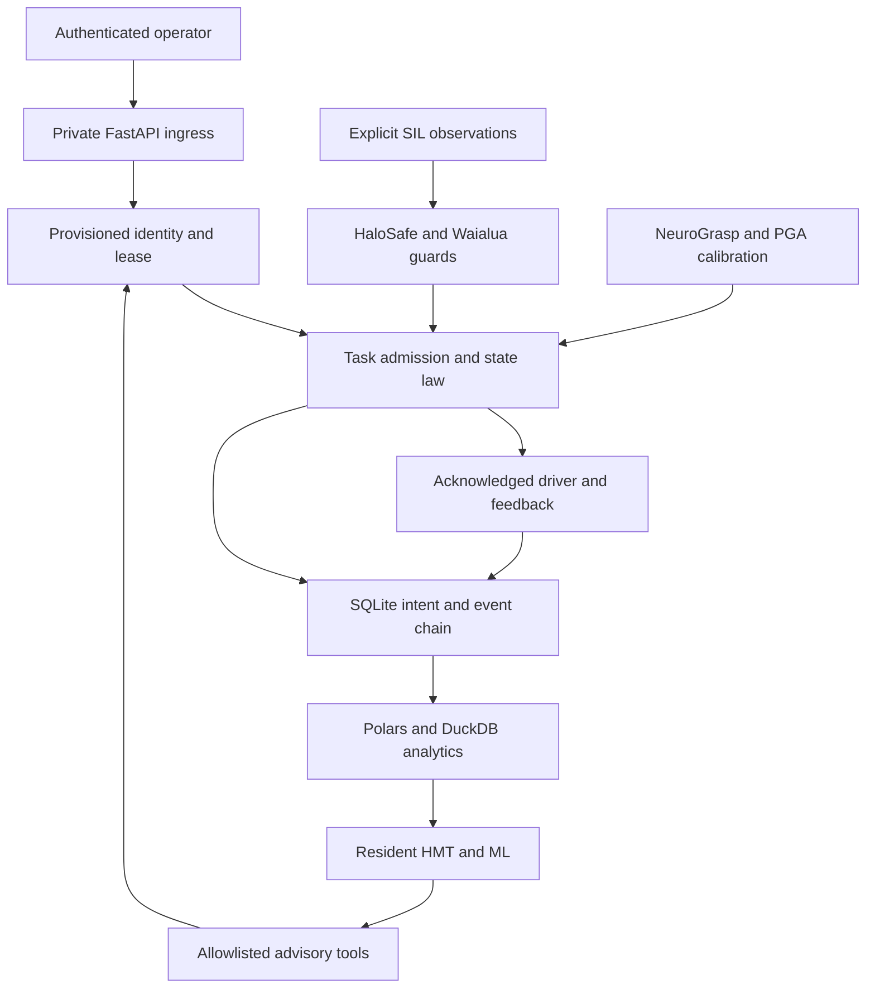

# Architecture binding

The supplied three diagrams define trust boundaries and lifecycle. This release
implements the private edge-cell partition and its typed ingress. A robotics cell
owns mutable actuator state, so it uses one guarded process; horizontal scaling
applies to future stateless control/analytics clients, not simultaneous owners of
the same driver. No distributed leader-election guarantee is implied.

## Interfaces and invariants

INV-01: no side effect before a durable intent and valid operator, epoch, observation,
substrate, workspace and speed checks. Revalidate before movement, gripper action
and verification. INV-02: SUCCEEDED requires acknowledged commands and finite,
matching position plus object-held feedback. INV-03: a resident proposal never
becomes driver input. INV-04: event hashes and task projection agree. INV-05:
restart never reissues unfinished motion. INV-06: invalid telemetry remains a gap.

## Mathematics

- PGA metric (0,1,1,1), geometric product and reverse: fixed 16-coefficient representation.
- Motor point sandwich `M P reverse(M)`: calibration transform with classical parity checks.
- PCA covariance eigensystem: ranked grasp candidates and ambiguity rejection.
- Closest point on commanded segment: path separation, not endpoint-only safety.
- Protective distance composition: `S = vh(Tr+Ts)+vrTr+Db+Z` with measured physical constants held external.
- Admittance law: `M a + D v + K x = F` with bounded semi-implicit update in SIL.
