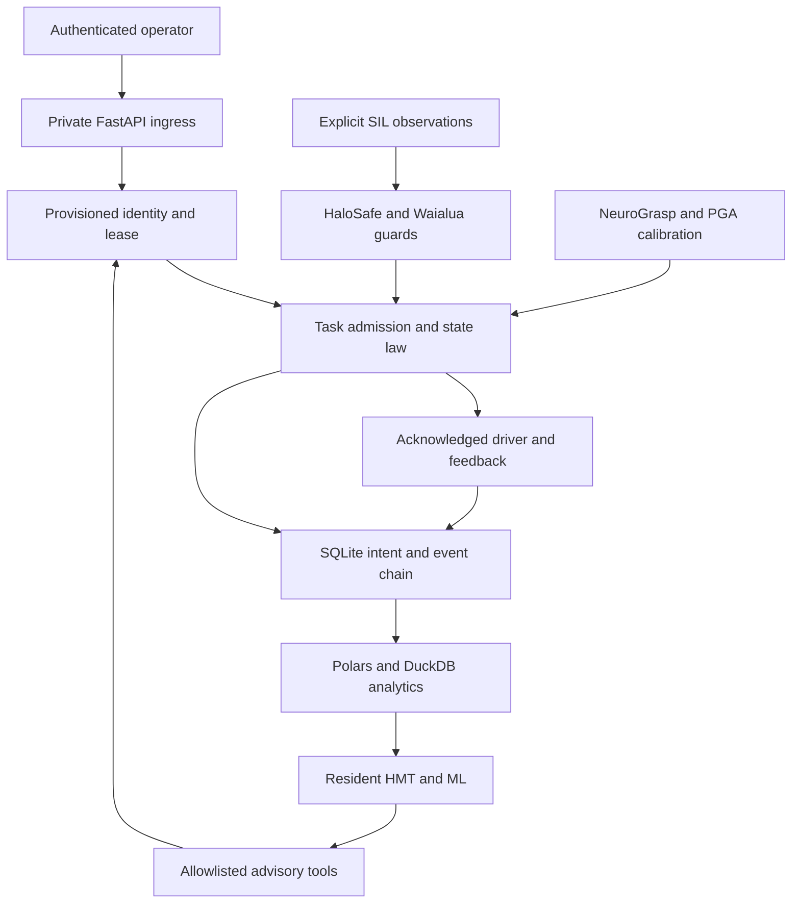

# Architecture binding

The supplied three diagrams define trust boundaries and lifecycle. This release
implements the private edge-cell partition and its typed ingress. A robotics cell
owns mutable actuator state, so it uses one guarded process; horizontal scaling
applies to future stateless control/analytics clients, not simultaneous owners of
the same driver. No distributed leader-election guarantee is implied.

| Diagram element | Current binding | Acceptance boundary |
|---|---|---|
| TLS, WAF, redundant load balancers | Private loopback ingress with body, receive and rate bounds | External topology HOLD; no public ingress provisioned |
| FastAPI / Pydantic / uv | api.py, contracts.py, pyproject.toml, uv.lock | Supervisory software |
| Redis queue and sessions | Bounded local queue and provisioned leases; durable SQLite intents | Redis failover/distributed leases HOLD |
| Application nodes / Swarm | Single actuator owner and Driver protocol | Multinode deployment HOLD |
| LiteLLM / RRCA agent | OpenAI-compatible adapter and ResidentHMT qualification/admission | Local compatible servers or opt-in cloud; no hidden provider defaults |
| Primary, replicas and sharding | Local WAL database, transactional task projection, read-only replay | Replica consistency and sharding HOLD |
| Identity / policy / scanner | Scoped identities, epoch-bound Policy, typed allowlisted tools | OIDC/OPA and network MCP scanner HOLD |
| Audit / replay / Parquet | ledger.py and analytics.py | Local durable evidence; host access controls required |
| Observability plane | Typed status, event summaries, sensor trends, exported ledgers | Prometheus/Loki/Tempo/Grafana/Alertmanager integration HOLD |
| Agentic peripherals | Resident context and private callable tools | GraphBrain/MCP/CRU deployment HOLD |

## Interfaces and invariants

INV-01: no side effect before a durable intent and valid operator, epoch, observation,
substrate, workspace and speed checks. Revalidate before movement, gripper action
and verification. INV-02: SUCCEEDED requires acknowledged commands and finite,
matching position plus object-held feedback. INV-03: a resident proposal never
becomes driver input. INV-04: event hashes and task projection agree. INV-05:
restart never reissues unfinished motion. INV-06: invalid telemetry remains a gap.

All contract schemas are emitted in `docs/contracts.schema.json`. The RDF mapping
in `docs/field_bindings.ttl` specializes every domain field against the supplied
subtype ontology; a mapping is a declared semantic binding, not a claim that the
upstream ontology already names these robotics fields. Source SHA-256 values
appear in `docs/source_provenance.json`.

## Mathematics

| Formula binding | Implementation | Check |
|---|---|---|
| PGA metric (0,1,1,1), geometric product and reverse | geometry.py, fixed 16-coefficient representation | Classical rigid-transform parity and inverse |
| Motor point sandwich M P reverse(M) | Calibration.transform | Rotation/translation and finite/norm rejection |
| PCA covariance eigensystem | vision.py | Ranked candidates and ambiguity ratio |
| Closest point on commanded segment | HaloSafe._path_distance | Crossing path is rejected even when endpoint is distant |
| S = vh(Tr+Ts)+vrTr+Db+Z | HaloSafe.protective_distance | Configured floor and speed scaling; measured physical constants HOLD |
| M a + D v + K x = F; bounded semi-implicit update | AdmittanceController.step | Finite state and declared integration bounds |

Formula-family IDs in source annotations refer to the supplied mobile field cards;
the protection-distance composition is an engineering guard derived from kinematic
terms, not an assertion of ISO certification or a copied approved hardware control law.
