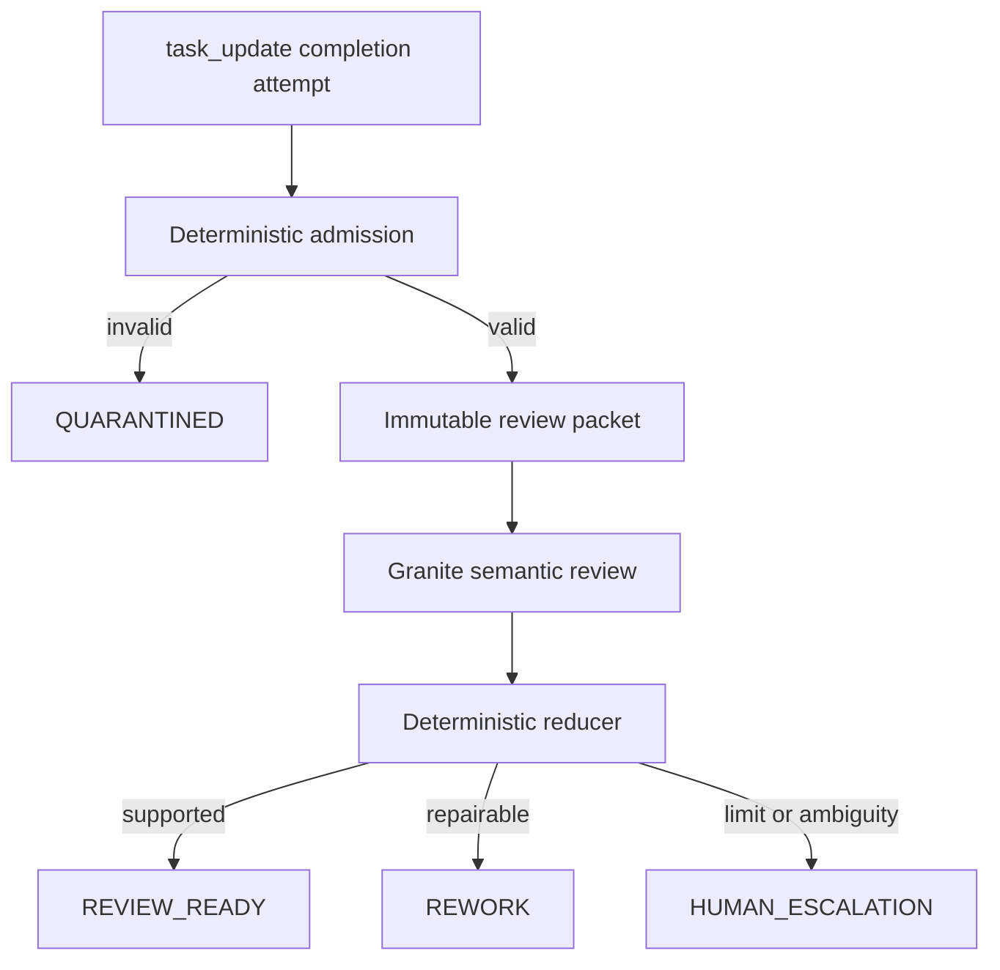

# HMT Model Roles and Convergence Policy v1.0.0

**Policy ID:** `HMT-MODEL-ROLES-CONVERGENCE`  
**Status:** `FROZEN`  
**Decision authority:** Human Architect  
**Effective date:** 2026-09-02  
**Scope:** HMT Quickstarter repositories, embedded MCP control planes, GraphRAG evidence paths, and task-completion review.

## Decision

The deployable HMT model stack is:

| Role | Primary component | Secondary / edge component | Authority ceiling |
| --- | --- | --- | --- |
| Orchestration | LFM instruct/tool profile | Config-swappable qualified LFM checkpoint | Propose decomposition and admitted tool calls only |
| Semantic supervision and convergence | IBM Granite 3.3 2B Instruct | None in baseline | Return structured findings and a non-binding disposition recommendation |
| State disposition | Deterministic reducer | None | Apply schema, evidence, policy, retry, and escalation rules |
| Time-series forecasting | Amazon Chronos-2 | Datadog Toto 2.0 | Return bounded forecasts through the common forecasting interface |
| Classical graph core | NetworkX + DuckDB projection | None | Deterministic graph storage, projection, retrieval, and lineage |

Scikit-learn convergence training is removed from the baseline. TimesFM is removed from every deployable profile, dependency set, model registry, and admission path. Existing TimesFM experiments may be retained only as archived evidence; they are not executable architecture dependencies.

## Non-negotiable separation of roles

### LFM orchestrator

LFM interprets admitted missions, proposes task decomposition, selects registered tools, sequences calls, and packages evidence references. It may not approve completion, alter authority, bypass policy gates, or adjudicate its own work.

### Granite semantic supervisor

Granite reviews an immutable, task-scoped completion packet against the user request, pinned policy, accepted decomposition, definition-of-done items, and cited evidence. It performs semantic checks that deterministic code cannot fully express.

Granite may:

- classify each requirement as `SATISFIED`, `UNSATISFIED`, `CONTRADICTED`, or `INSUFFICIENT_EVIDENCE`;
- identify task-scoped rework;
- explain why evidence does or does not support a requirement;
- recommend `REVIEW_READY`, `REWORK`, or `HUMAN_ESCALATION`.

Granite may not:

- call repository, task, forecasting, network, or authority tools;
- mutate the task board, GraphRAG memory, policy, or evidence;
- retrieve outside the review packet;
- grant `DONE`;
- convert missing evidence into a pass;
- override the deterministic reducer.

### Deterministic reducer

The reducer is ordinary bounded code, not a model. It validates packet hashes, schema, requirement coverage, evidence references, contradiction flags, retry counters, and policy gates. It alone maps an admitted semantic result to a task-control disposition.



`REVIEW_READY` means the completion packet is ready for the Human Architect or admitted human reviewer. It does not mean `DONE`.

## Completion review contract

Every semantic review receives one immutable `SupervisorReviewPacket` containing only:

- packet ID, schema version, creation time, and content hash;
- task ID, parent mission ID, and current task status;
- user-request text plus its hash;
- pinned policy IDs, versions, and hashes;
- accepted decomposition and parent requirements;
- definition-of-done requirement IDs;
- changed-artifact paths and content hashes;
- deterministic validation receipts;
- task-scoped GraphRAG evidence excerpts and stable evidence references;
- prior semantic findings for the same task;
- separate admission and semantic-review attempt counters.

The supervisor must return exactly one finding for every definition-of-done requirement:

```json
{
  "requirement_id": "DOD-001",
  "verdict": "SATISFIED",
  "evidence_refs": ["evidence:sha256:..."],
  "reason_code": "EVIDENCE_DIRECTLY_SUPPORTS_REQUIREMENT"
}
```

The full response contains `findings`, `unresolved_items`, and one advisory `recommended_disposition`. Unknown fields, missing requirements, invalid evidence references, non-enumerated verdicts, or malformed output fail closed.

## Convergence policy

Granite owns semantic re-review; it does not own the state transition.

1. The first admitted completion attempt receives semantic review.
2. A reducer-approved `REWORK` result returns bounded findings to the task outbox.
3. One additional autonomous semantic rework cycle is permitted.
4. A third semantic-review failure, repeated unresolved finding, policy ambiguity, or model-runtime failure routes to `HUMAN_ESCALATION`.
5. Deterministic admission failures do not consume the semantic-review counter; they increment the separate admission-attempt counter and fail closed.
6. No model output can change `REVIEW_READY` to `DONE`. Human or separately admitted authority remains required.

There is no learned convergence classifier in the baseline. Retry and escalation behavior is finite, inspectable, and policy-configured.

## Forecasting profiles

All forecasting backends implement the same bounded tool contract. The interface accepts validated targets, past covariates, optional future covariates, context bounds, horizon bounds, and requested quantiles. It returns model metadata, point forecasts when supported, quantile forecasts, input/output hashes, and deterministic validation receipts.

### `primary` — Chronos-2

Chronos-2 is the default deployable forecasting backend because it combines a small footprint with Apache-2.0-licensed weights, multivariate forecasting, covariate support, and probabilistic outputs.

### `secondary_edge` — Toto 2.0

Toto 2.0 is the compatible secondary and edge-oriented option. Checkpoint size, device, quantization, and resource ceilings are selected through configuration without changing the tool schema or pipeline.

### Prohibited — TimesFM

TimesFM is excluded from active HMT architecture because the selected weights do not permit the intended production and commercial use. The prohibition is structural:

- no active model profile;
- no runtime download;
- no optional dependency in deployable builds;
- no fallback selection;
- fail-closed admission if a stale configuration requests it.

Archived TimesFM receipts may remain as historical research lineage, clearly marked `NON_DEPLOYABLE_ARCHIVE`.

## Configuration surface

Only swappable implementation details belong in configuration:

- enabled role profile;
- checkpoint identifier and pinned revision;
- device and quantization;
- context, horizon, series, token, latency, and memory ceilings;
- license-policy identifier;
- local model path and offline-only flag.

Role authority, reducer rules, required packet fields, evidence requirements, retry ceilings, and controlled dispositions are policy, not configuration.

## Required telemetry

Every invocation emits append-only lineage with:

- transaction, mission, task, attempt, packet, model, and policy IDs;
- checkpoint revision, runtime, device, quantization, and license-policy result;
- input and output hashes;
- deterministic admission and reducer decisions;
- semantic findings and stable evidence references;
- latency, bounded resource observations, errors, and final disposition.

Telemetry and tuning lanes remain read-only with respect to authority and task state. Training records can be harvested only from admitted, content-addressed evidence packets.

## Qualification and replacement gates

A checkpoint is admitted only after an HMT tracer bullet proves, in a disposable live sandbox:

1. local initialization and bounded execution;
2. required structured-output or forecasting contract;
3. deterministic schema rejection and fail-closed behavior;
4. complete telemetry and content-addressed evidence lineage;
5. no network egress by default;
6. license compatibility for the selected execution profile;
7. resource ceilings on the target device;
8. replayable golden cases and negative cases;
9. no authority leakage or task-state mutation;
10. documented swap and rollback points.

Failure to validate the thin end-to-end slice makes that architectural direction infeasible under HMT policy.

## Migration order

1. Remove TimesFM from active config, dependencies, registry entries, smoke tests, and fallback logic.
2. Bind Chronos-2 to the existing forecasting interface and qualify it with the tracer-bullet suite.
3. Bind Toto 2.0 to the same interface as `secondary_edge` and run the identical contract suite.
4. Add Granite 3.3 2B behind the completion-review ingress with no general tool registry exposure.
5. Add immutable review-packet construction and strict semantic-result validation.
6. Add the deterministic reducer, separate counters, two-cycle rework ceiling, and third-failure escalation.
7. Verify LFM cannot call or impersonate the supervisor, and Granite cannot call operational tools.
8. Run the complete mission-to-validated-JSONL tracer bullet before notebook promotion.

## Frozen references

- Baseline tools: `HMT_Baseline_MCP_Tools_v1.0.0.json` — SHA-256 `ff34e5ed4e999e5c60ce84ba864ab1fe7d315f18b090f91d292f5c46e788face`
- HMT axioms: `HMT_Axioms_Policy_v1.0.0.json` — SHA-256 `a32f92ab9c090c25a8d19e5a8e17dd97ecb289ab1aab7f29c216b4f2bba982da`

This policy does not modify the frozen 12-tool MCP baseline. Semantic supervision is an internal completion firewall stage, and forecasting backends remain bounded tools behind existing admission.

## Qualification references

- [IBM Granite 3.3 2B Instruct model card](https://huggingface.co/ibm-granite/granite-3.3-2b-instruct)
- [Amazon Chronos-2 model card](https://huggingface.co/amazon/chronos-2)
- [Datadog Toto 2.0 model card](https://huggingface.co/Datadog/Toto-2.0-4m)
- [TimesFM 3.0 weight license](https://huggingface.co/google/timesfm-3.0-pytorch/blob/main/LICENSE)

